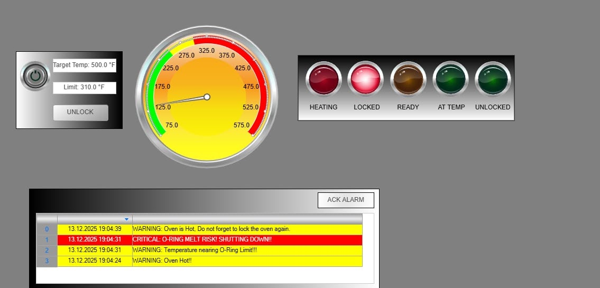
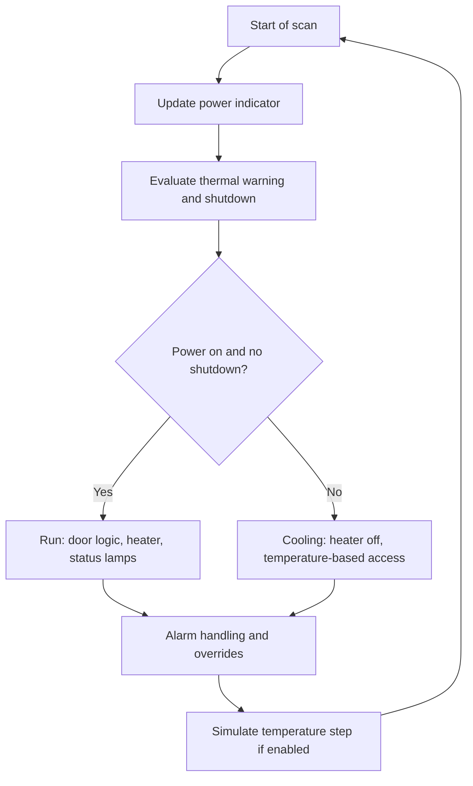

# Industrial Alarm Oven Monitoring System

**A group academic project exploring PLC control, HMI visualization, and alarm handling in CODESYS V3.**

| Project | Details |
| --- | --- |
| Team | Kent Alia · John Paul Maluya ([@pauul14](https://github.com/pauul14)) |
| Course | BCA153 — Computer Applications, MSU-IIT |
| Report date | December 14, 2025, as stated on the original site |
| Environment | CODESYS V3 · IEC 61131-3 Structured Text · software simulation |
| Archive status | Recovered published source and documentation; native project unavailable |

> The original CODESYS project files were lost after a laptop reformat, as reported by John Paul. This repository preserves material recovered from the team's published project page. It is a portfolio archive, with no verified build or runnable CODESYS project included.



[Original project documentation](https://sites.google.com/g.msuiit.edu.ph/aliamaluyabca153finalproject/home?read_current=1) · [Linked demonstration](https://www.youtube.com/watch?v=LV5riKL5myQ) · [Recovered PLC source](src/recovered/PLC_PRG.st) · [Recovery and provenance](docs/recovery.md)

## Project overview

The project simulates an industrial oven's temperature response and operator controls. Its PLC program combines setpoint-based heater switching, simulated heating and cooling, door-lock logic, indicator lamps, and warning/shutdown flags. The published HMI presents controls, a temperature gauge, status indicators, and an alarm table.

The original report explicitly describes a **software-only system with no physical hardware**. This archive does not claim a deployed industrial controller, hardware validation, or certified safety behavior.

## Documented features

- Main power control and adjustable temperature setpoint.
- Heater command based on current temperature versus setpoint.
- Fixed warning/shutdown thresholds and a configurable O-ring warning limit.
- Door locking during operation and cooling, with a maintenance bypass.
- Power, heating, at-temperature, and lock-status indicators.
- CODESYS alarm configuration and an HMI acknowledgement button, as documented on the site.
- Temperature changes simulated each PLC scan.

The preserved code has limitations that affect some of these behaviors. In particular, acknowledgement handling and temperature-unit labeling need review; see [code observations](docs/code-review.md). No corrections have been presented as recovered original work.

## System flow

The published flowchart summarizes the cyclic sequence below. Its block names are explanatory labels, not recovered function definitions.



[System design and variables](docs/system-design.md) · [Original flowchart](assets/diagrams/figure-5-flowchart.png)

## Screenshots and reported testing

The original page publishes three screenshots and lists seven simulation test scenarios: basic heating, at-temperature indication, run-state door locking, maintenance bypass, warning activation, critical shutdown, and cooling access. These are historical documentation, not tests rerun for this archive.

| Published artifact | What it shows |
| --- | --- |
| [Figure 1 — HMI](assets/screenshots/figure-1-hmi.jpg) | Temperature inputs, gauge, status lamps, and readable warning/critical messages |
| [Figure 2 — alarm interface](assets/screenshots/figure-2-alarms.jpg) | HMI and colored alarm-table rows; message text is not legible in this capture |
| [Figure 3 — project tree](assets/screenshots/figure-3-project-tree.png) | PLC_PRG, alarm configuration, tasks, Visualization Manager, and MainVisu |
| [Figure 4 — linked video](https://www.youtube.com/watch?v=LV5riKL5myQ) | Demonstration link embedded on the original site; video contents not independently reviewed for this archive |
| [Figure 5 — flowchart](assets/diagrams/figure-5-flowchart.png) | Simplified cyclic control and alarm flow |

[Testing evidence and limits](docs/testing-and-results.md)

## Repository contents

```text
assets/
  diagrams/                 Original published flowchart image
  screenshots/              Original published HMI and project-tree images
docs/
  system-design.md          Design summary grounded in the published listing
  code-review.md            Static observations and documentation discrepancies
  testing-and-results.md    Historical scenarios and verification limits
  recovery.md               Recovery method, missing files, and provenance
provenance/
  PLC_PRG.published.txt      Extracted published listing before source normalization
  sources.json              Source inventory, transformations, and SHA-256 hashes
src/recovered/
  PLC_PRG.st                Formatting-normalized recovery of the published listing
CREDITS.md                  Team attribution and AI-use disclosure
RIGHTS.md                   Permission scope and third-party rights
```

## Reading or rebuilding the project

Start with the recovered source and design notes. There is no `.project` or `.projectarchive`, recovered visualization definition, alarm configuration export, library lock, task-period record, or build output. The exact CODESYS version and original settings are unknown.

A future reconstruction would need to restore the CODESYS application, declarations and program body, visualization bindings, alarm definitions, libraries, and task settings, then address the listed code issues and validate in simulation. That would be new work and should be tracked separately from this archive. The recovered listing has **not been compiled or executed** as part of this recovery and is not suitable for operating a real oven.

## Team and rights

This was a **joint project by Kent Alia and John Paul Maluya**. The published report does not identify individual task ownership, so this repository does not assign programming, HMI, or documentation work to either person individually.

Recovered code and images are reproduced with John Paul's confirmation that Kent does not object to their inclusion. This is permission for the portfolio publication, not an open-source license or a claim of rights over third-party interface artwork. See [credits](CREDITS.md) and [rights](RIGHTS.md).
