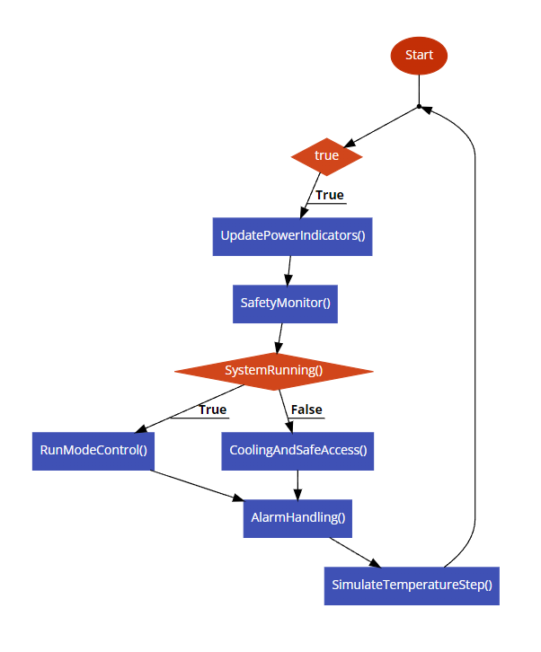

# Documented system design

This summary is grounded in the [original project page](https://sites.google.com/g.msuiit.edu.ph/aliamaluyabca153finalproject/home?read_current=1) and [recovered listing](../src/recovered/PLC_PRG.st). It describes the published simulation, not a verified industrial implementation.

## Environment and application structure

The report names CODESYS V3 and IEC 61131-3 Structured Text. The project-tree screenshot shows a CODESYS Control Win V3 device, PLC_PRG, Alarm Configuration, Library Manager, Task Configuration, Visualization Manager, and MainVisu. AlarmManagerTask, MainTask, and VISU_TASK are visible. Their periods, priorities, library versions, and bindings cannot be recovered from that image.

The report explicitly states that the project uses no physical hardware. Heater and door variables represent simulated commands; no field I/O mappings or real temperature sensor are established by the recovered documentation.

## Inputs and outputs

| Variable | Type / published initial value | Role |
| --- | --- | --- |
| PowerSwitch | BOOL | Operator power command; also forced false on critical temperature |
| Setpoint | REAL / 250.0 | Heater target |
| OringLimit | REAL / 310.0 | Configurable warning threshold |
| AckAlarm | BOOL | Acknowledgement input; see the reset-order observation |
| BypassButton | BOOL | Maintenance door-unlock request |
| CurrentTemp | REAL / 75.0 | Simulated process temperature |
| HeaterOn | BOOL | Simulated heater command |
| DoorLocked | BOOL | Simulated lock command |
| SafeToOpen | BOOL | Temperature-based access indication while off/cooling |
| LedPower, LedRamping, LedAtTemp | BOOL | Power and process indicators |
| LedLocked, LedUnlocked | BOOL | Lock-state indicators |
| AlarmOring | BOOL | Thermal warning flag |
| AlarmShutdown | BOOL | Critical shutdown flag |
| AlarmTooHotEntry | BOOL | Hot-surface / bypass warning flag |
| Simulation | BOOL / TRUE | Enables per-scan temperature changes |

Boolean initial values are not explicitly assigned in the published declarations. This table preserves only the explicit numeric and simulation initializers.

## Scan sequence and thresholds

The program is a single cyclic listing. The original flowchart uses descriptive blocks such as `SafetyMonitor()` and `RunModeControl()`; those are not separate recovered POUs.

1. Copy PowerSwitch into LedPower.
2. At CurrentTemp >= 320.0, set shutdown and force power/heater off. Otherwise, at >= 300.0 set the warning. Below 280.0, clear both thermal flags in this first stage.
3. If power is on and shutdown is false, run heater and door logic. The heater is on while CurrentTemp < Setpoint. The at-temperature indicator is true for CurrentTemp >= Setpoint - 5.0. The bypass can unlock the door when the earlier LedAtTemp value and BypassButton are true; SafeToOpen stays false during run.
4. When off or shut down, stop the heater and clear process indicators. Unlock only if CurrentTemp < 75.0; otherwise retain the lock.
5. Apply acknowledgement reset, hot-entry warning, dynamic warning check, and indicator correction. The listing includes a later acknowledgement-dependent shutdown-clear block, subject to the reset-order issue in [the code review](code-review.md).
6. If simulation is enabled, add 0.5 when heating; otherwise subtract 0.2 when CurrentTemp > 25.0.

The configurable OringLimit sets a warning; it does not replace the fixed 320.0 shutdown condition. The source has no explicit unit conversion. Original screenshots label inputs in °F, while the report calls ambient temperature 25.0°C. Thresholds are therefore recorded as raw numeric values pending unit reconciliation.

## HMI and alarm integration

The report describes power/setpoint/limit controls, an acknowledgement button, gauge, status lamps, and an alarm table. The screenshots also show an UNLOCK control. The exact event binding between that control and BypassButton was not recovered.

The first screenshot displays warning and critical messages, including an O-ring shutdown warning. The second shows colored rows but no readable message text. The report names CODESYS Alarm Configuration and Alarm Manager, but the actual alarm classes, conditions, acknowledgement rules, storage settings, and HMI bindings are unavailable.

See [code observations](code-review.md) before interpreting this sequence as a reliable safety design.
