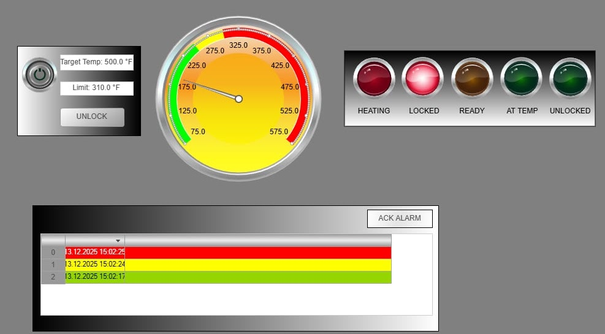
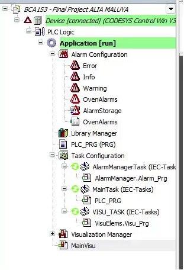

# Reported testing and available evidence

The [original report](https://sites.google.com/g.msuiit.edu.ph/aliamaluyabca153finalproject/home?read_current=1) says the system was tested in simulation by varying PowerSwitch, Setpoint, and OringLimit while monitoring temperature, indicators, locks, and alarms. Its testing section lists the following scenarios and intended checks. No new execution or pass/fail claims are attached to this recovery.

| Historical scenario | Check described by the report |
| --- | --- |
| Power and basic heating | Power indication; heater on below target; heating indicator |
| At-temperature indication | LedAtTemp true at or above Setpoint - 5.0; ramping indicator off |
| Door locking during run | DoorLocked true and lock indicators agree |
| Maintenance bypass | At temperature, a bypass request unlocks the door and raises the entry warning |
| Thermal warning | Warning at the fixed threshold or above the configurable limit |
| Critical shutdown | At 320.0 or above, shutdown flag true and power/heater false |
| Cooling access | While off/cooling, unlock below 75.0 and assert SafeToOpen |

The report uses `DoorLock` in one bypass-test instruction; the actual published declaration is `DoorLocked`.

## Screenshots

Figure 1 shows controls, a gauge, lamps, and readable warning/critical alarm entries. It supports the existence of the interface and displayed alarm messages at capture time. It does not prove timing, control correctness, acknowledgement semantics, or real hardware operation.

Figure 2 shows colored alarm rows and an ACK ALARM button. The message area is not legible in this image, so no message text or alarm outcome is inferred from it.

Figure 3 shows application components, including PLC_PRG, alarm configuration, tasks, and MainVisu. It is an image, not a recovered project export or independently verifiable build record.

## Video and flowchart

The original page embeds [this YouTube demonstration](https://www.youtube.com/watch?v=LV5riKL5myQ) as Figure 4. Its link was recovered from the page's embed markup. The video was not independently watched or assessed during recovery and is not rehosted here.

[Figure 5](../assets/diagrams/figure-5-flowchart.png) is a simplified explanatory flowchart. It is evidence of the documented design, not runtime execution.

## Validation performed for this archive

- Extracted the published PLC listing and checked the normalized source against it.
- Inspected the four recovered images and matched them to their adjacent source captions.
- Recorded source URLs, transformations, and SHA-256 hashes.
- Checked repository file inventory, local documentation links, and obvious credential patterns.
- Read the source for discrepancies documented in [code-review.md](code-review.md).

No CODESYS build, PLC execution, HMI reconstruction, hardware test, performance measurement, or formal safety validation was performed. The historical report provides no per-test execution logs or measured pass/fail dataset.
